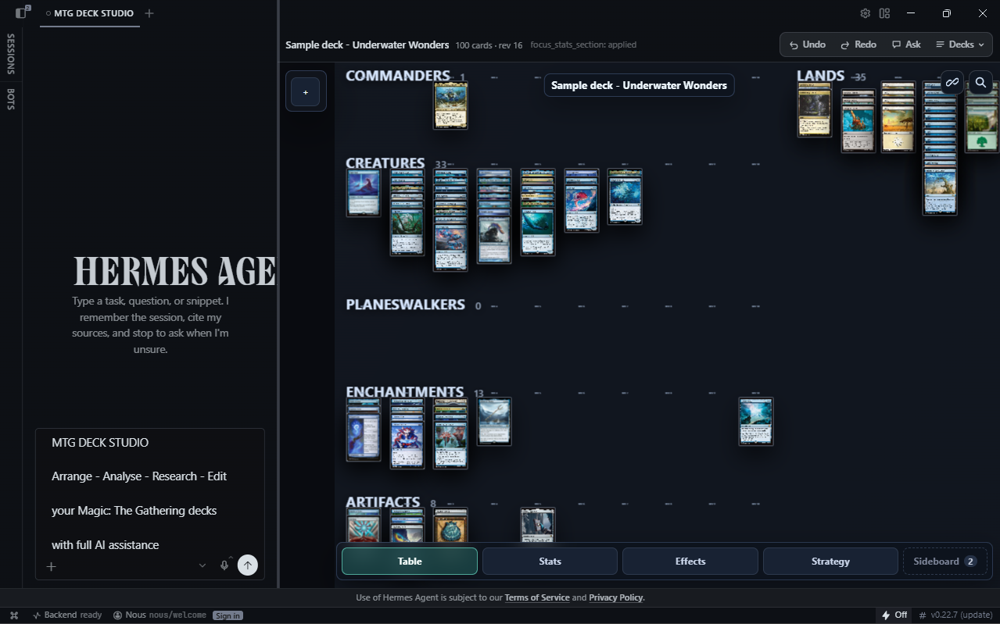
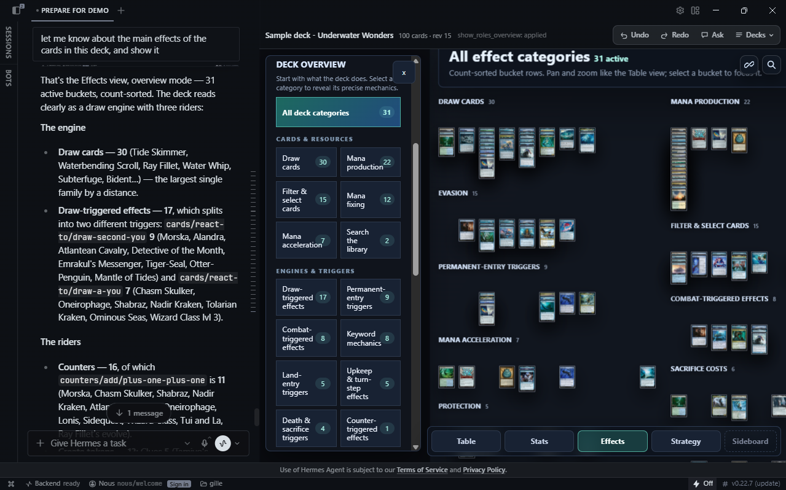
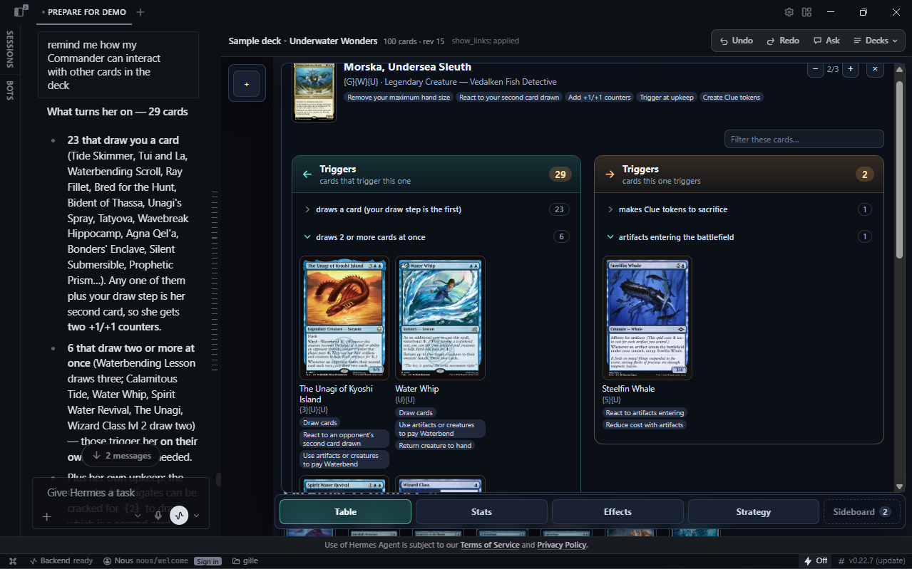
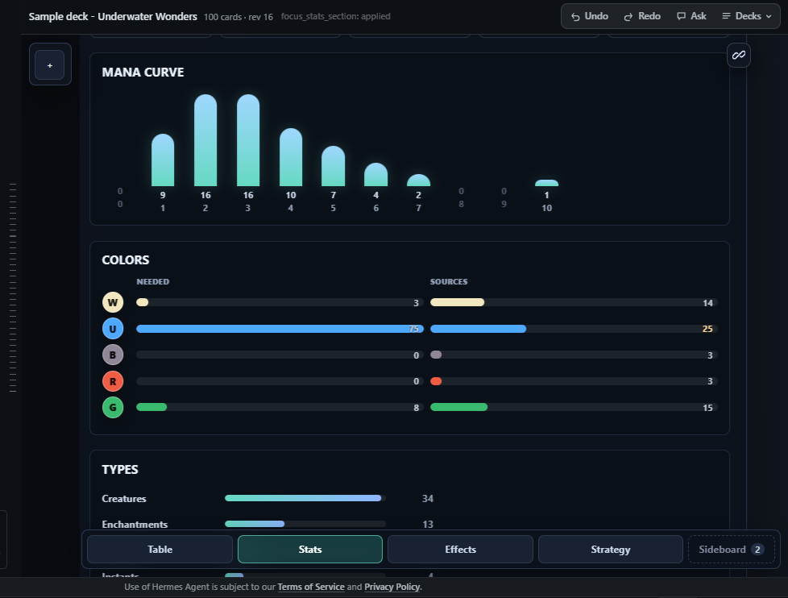
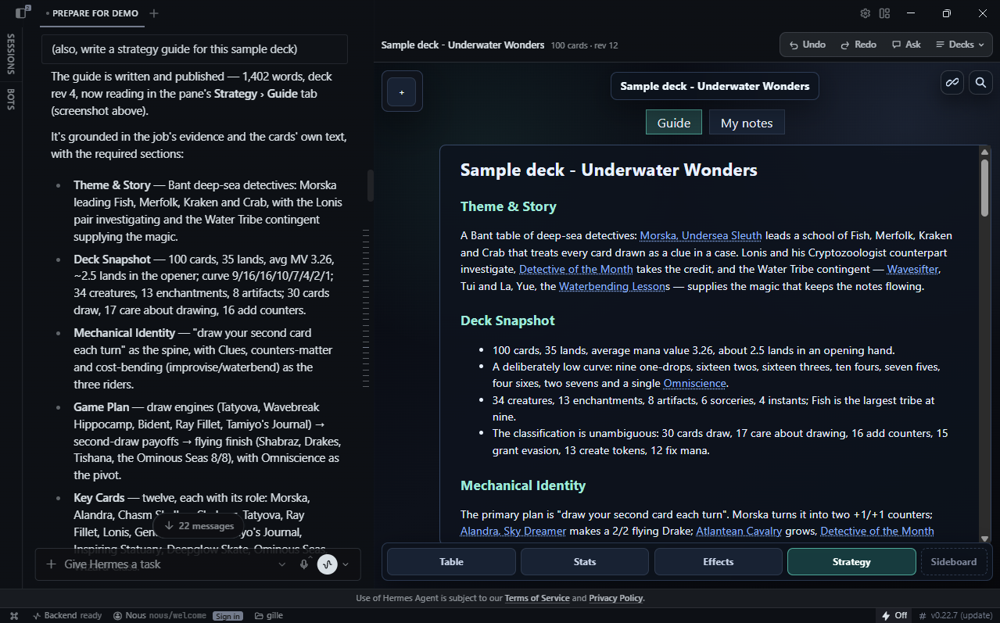
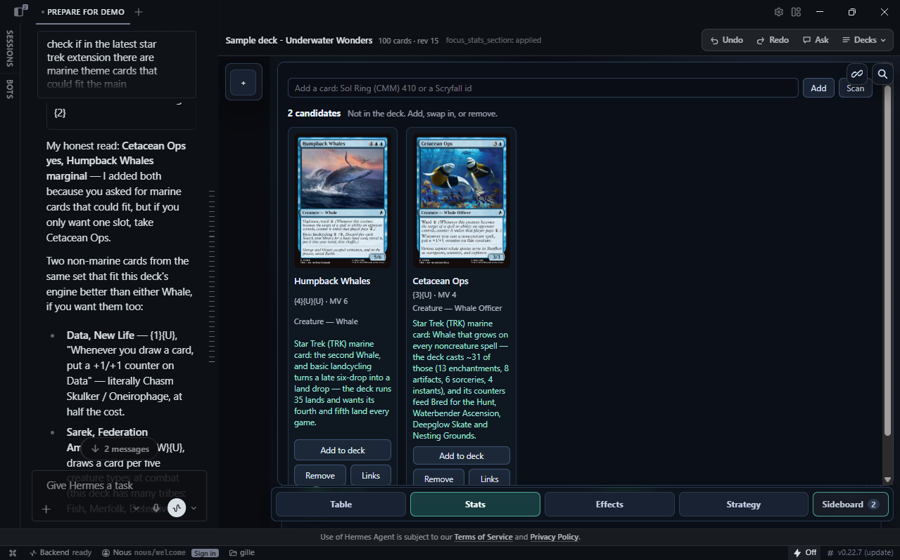

# MTG Deck Studio

A Hermes Desktop plugin to manage your Magic: The Gathering decks. 

Arrange - Analyse - Research - Edit your decks with full AI assistance.

Your decks live on a table beside the chat. The AI has context of the deck and cards you select.


Requires Hermes 0.22.7+. MIT. No Python dependencies beyond Hermes.

## Why

**Test an edit without touching your cards.**

No sleeving, no proxies, no clearing the table to see how a change plays out. Every card is a digital twin you can drag, sort and rearrange on an intuitive table — try the cut, look at the curve, undo it, try something else.

**Let the AI do the reading.**

Ask it to check a synergy between two cards, remind you what a deck is actually trying to do, or research cards that fit your vision — it answers from your deck's real contents, so the advice is about your list, not about decks in general.

## Features

- **One deck, two hands.** 
  
  Both You and the AI can act on your decks.

- **Seven AI tools.**
  
  Read the deck, run 49 operations, search Scryfall, read the graph, write the guide, manage the sideboard and the library.

- **Adaptable.**
  
  The more you use it, the more the AI knows how to execute your requests.
  
  Want a new feature ? Just ask for it in the chat.

- **A table, not a list.** 
  
  Intuitive UI to organise your decks, mirroring physical manual handling of cards.

- **Understanding your cards.** 
  
  Every card is parsed into effect families and mechanics, with the clause behind each.

- **Links with evidence.** 
  
  For any card: what card trigger its effects, what cards it triggers, what cards affect it, what cards it affects.

- **Deck statistics.** 
  
  Curve, colour demand against sources, types, effect spread, your own categories.

- **Strategy guides, grounded.** 
  
  Along your own notes, AI generated strategy guide to pilot the deck, built from the deck's own evidence.

- **Sideboard.**
  
  Keep track of eventual additions to your deck, and how they fit in.

- **Research inside the rules.** 
  
  Commander-legal, paper-only, inside the deck's colour identity.

- **Import what you have.** 
  
  Deck JSON, a folder of them, MythicTools CSV, a decklist, a photo of a card.

- **Auditable classification.** 
  
  Rule versions stamped on every card; reclassify in one operation.

- **Data saved locally.**
  
  Everything lives in the plugin's data directory; the only traffic is Scryfall and the LLM calls.

## Using the studio



The plugin owns one pane, right of the chat, with a rectractable left side menu, and tabs  on the bottom edge.

### The chat — anything the studio does, the AI does too

Every control listed below is also an operation the AI can run from the conversation on the left: open a deck, import one, move or remove cards, set effects and sections, reclassify, open a card's links, write the guide, manage the sideboard, and more.

Everything you see, the AI knows too.

You go to the pane to see and touch the deck; you go to the chat when you want it done, or want a deck builder teammate.

Real requests you can send through:

- "Remind me how my commander interacts with the rest of the deck" -> opens its linked cards panel, with context of the mechanics of the deck.
- "Write a strategy guide for this deck" -> a grounded primer, published into the Strategy view.
- "Are the mana sources OK for this deck?" -> colour pips against colour sources, per colour.
- "What are the main effects in this deck?" -> effect families with their counts.
- "Show me the main creature and artifact subtypes" -> gives them their own table sections.
- "Check the latest extension set for marine cards that fit this deck's synergies, and put them in the sideboard" -> search, candidates, each with the reason it was proposed.
- "Which of my decks is the most likely to make my opponents rage" -> rank your library by the most annoying mechanics.

### Header and deck menu

| Control         | What it does                                                                                                                               |
| --------------- | ------------------------------------------------------------------------------------------------------------------------------------------ |
| **Decks**       | Open a stored deck, import one, create one, close the pane.                                                                                |
| **Save deck**   | Write a JSON copy into the studio folder.                                                                                                  |
| **New deck**    | Start an empty deck.                                                                                                                       |
| **Close deck**  | Clear the pane without deleting anything.                                                                                                  |
| **Undo / Redo** | Step through every edit, whichever view made it.                                                                                           |
| **Ask**         | Send a request to the chat, about the deck or the current selection (in Table view, drag right click to draw a rectangle to select a card) |
| **Links**       | Open the link panel for the selected card: what it triggers, what triggers it, what improves it.                                           |
| **Search**      | Find a card. Enter steps through every place it appears. Escape closes.                                                                    |

### On the table

| Control                  | What it does                                                                                         |
| ------------------------ | ---------------------------------------------------------------------------------------------------- |
| Drag a card              | Move it; the position is saved with the deck.                                                        |
| Drag empty space / wheel | Pan and zoom the camera. Bigger / Smaller cards settle the zoom.                                     |
| Right Click              | Select a card, or open it in the link and effect views.                                              |
| Card actions             | Linked cards, its effects, move to sideboard, remove, flip a double-faced card, edit its mana value. |
| Reset Positions          | Put every card back in the automatic layout.                                                         |

### The four views and the sideboard

| View          | What you can do                                                                                                                                                                             |
| ------------- | ------------------------------------------------------------------------------------------------------------------------------------------------------------------------------------------- |
| **Table**     | Sections by type, subtype or your own; drag between them; counts on every header.                                                                                                           |
| **Stats**     | Curve, colours (needed against sources), types, effects, your own categories. Click a figure to select its cards.                                                                           |
| **Effects**   | Switch Overview and Granular Sections, open an effect to see its cards, read *More specific mechanics*, explain why a card has an effect, and open the review list of unclassified clauses. |
| **Strategy**  | Read the published guide, or write your own notes in the second tab.                                                                                                                        |
| **Sideboard** | Add to deck, swap for a deck card, remove, or open a candidate's links. Add a card by name or with **Scan**.                                                                                |

### Deck settings

- **Name Deck** — the title in the pane header and the library.
- **Subtype Sections** — give a tribe or card kind its own framed section, and show subtypes on the table.
- **Granular Sections** — mechanics on three or more cards get their own sections.
- **Custom Stats Categories**, **Utility Buckets**, **Add Bucket** — your own statistics and effects.
- **Reclassify Cards** — recompute every effect from Oracle text.
- **Zoom sensitivity**, **Placement rhythm** — how the table feels while you move cards.

## Screenshots

**Linked cards** — which cards a selected one triggers, and which trigger it, same for effects.



**Statistics** — mana curve, colour pips against colour sources, types of cards, effects categories.



**Strategy** — the generated guide, beside your own notes.



**Sideboard** — candidates, each with the reason it was proposed.



## AI tools

| Tool                        | What the AI gets                                                               |
| --------------------------- | ------------------------------------------------------------------------------ |
| `mtg_deck_studio_state`     | The deck: commanders, sections, curve, colour identity, selection, card text.  |
| `mtg_deck_studio_apply`     | 49 operations on the deck in the pane, each acknowledged with a revision.      |
| `mtg_deck_studio_decks`     | The library: list, open, import, create, export.                               |
| `mtg_deck_studio_search`    | Scryfall alternatives inside the colour identity, Commander-legal, paper-only. |
| `mtg_deck_studio_links`     | The synergy graph, with the clauses behind every pair.                         |
| `mtg_deck_studio_strategy`  | Prepare evidence, query it, publish a validated guide.                         |
| `mtg_deck_studio_sideboard` | Candidates: list, add, promote, replace.                                       |

- **Grounded.**
  
  The AI reads the deck before it speaks, and names the card and the reaction.

- **Traceable.** 
  
  Every change comes back with a revision; a write based on a stale view is refused.

- **In the rules.** 
  
  No suggestion outside the colour identity or Commander legality.

- **Explicit.**
  
  No pane open means `pane_unavailable`, not a silent success.

The bundled skill (`plugin/skills/mtg-deck-studio/`) is the AI's manual: which tool, how to read a link panel, how to run the strategy pipeline.

## Install

```bash
hermes plugins install GillesGaelBERNARD/mtg-deck-studio/plugin --enable
```

`/plugin` is the subfolder holding `plugin.yaml`. Restart the gateway, then:

1. **Capabilities › Plugins** → Rescan → switch on "MTG Deck Studio". The table opens beside the chat.
2. **Decks** menu → import a deck JSON, a MythicTools CSV, a decklist, or create one.
3. Ask in the chat: rename, add, remove, set commanders, undo, "write a strategy guide".

## What it talks to

- Card data and images: the public [Scryfall API](https://scryfall.com/docs/api). No key.
- Your decks, sideboards, scans and guides: the plugin's profile-scoped data directory.
- Nothing else. No telemetry, no update checker, no stored credentials. See [NOTICE.md](NOTICE.md).

## Develop and test

- `python -m unittest discover -s plugin/tests -p "test_[cls]*.py"` — core, store, link rules, strategy, Scryfall, exports.
- `uv run --no-project --with playwright python -m unittest tests.test_viewer_browser` — drives the viewer in a sandboxed Chromium frame.
- `python scripts/dev_install.py` — a live-reload development copy; `--check` says if it is current.
- `python scripts/reclassify_all.py` — recompute every stored deck with the current classifier.
- Tests use `plugin/tests/fixtures/sample-deck.json`: *Sample deck - Underwater Wonders*, 100 English cards, images stripped (287 kB).

## Repository layout

| Path                  | Purpose                                                                                                |
| --------------------- | ------------------------------------------------------------------------------------------------------ |
| `plugin/`             | Manifest, seven tools, deck store, Scryfall client, classifier, link graph, pane, viewer, skill, tests |
| `plugin/core/`        | Python: store, operations, classifier patches, link rules, strategy, exports                           |
| `plugin/viewer/`      | The table: viewer HTML, `studio.js`, `ui.css`, framing                                                 |
| `scripts/`            | Dev install, reclassify, name index, link audits                                                       |
| `assets/screenshots/` | The screenshots in this README                                                                         |

## License

MIT — see [LICENSE](LICENSE). Magic: The Gathering is a trademark of Wizards of the Coast; this project is unofficial.
